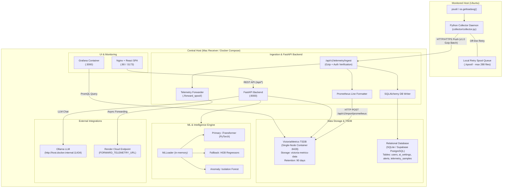
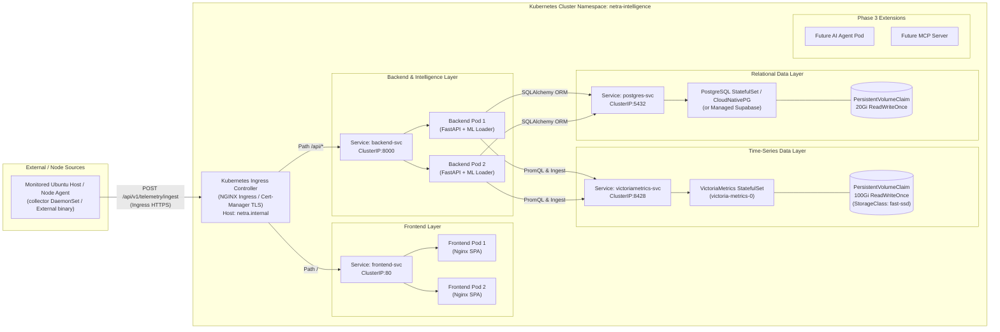

# Netra Intelligence vNext — Kubernetes Architecture Audit (Phase 2, Step 1)

**Date**: September 2026  
**Document Status**: Complete Audit (Discovery & Architecture Phase Only — No Implementation Executed)  
**Target File**: `docs/kubernetes_architecture_audit.md`  

---

## Executive Summary

This architecture audit evaluates the transition of the **Netra Intelligence** platform from its current hybrid, VM-centric architecture (monitored Ubuntu node pushing telemetry to Mac receiver and VictoriaMetrics) to a production-ready **Kubernetes (K8s)** architecture.

The objective of this migration is not merely "containerizing everything into K8s", but defining a multi-workload, resilient, horizontally scalable platform capable of supporting:
- Multiple monitored workloads and host nodes.
- High-throughput telemetry ingestion and centralized time-series metric storage.
- Real-time ML forecasting (primary iTransformer, fallback HistGradientBoosting) and anomaly detection (Isolation Forest).
- Production REST APIs (FastAPI) and modern SPA Frontend (React/Nginx).
- Future integration points for **Phase 3 (Member 2 AI Agent + MCP Server)** and **Phase 4 (Demo Environment)**.

---

## 1. Current Architecture Overview

The current production runtime is structured across two primary physical/virtual compute environments connected over Tailscale:



### Architectural Key Points:
1. **Push Telemetry Collector**: Monitored Ubuntu server runs `collector/collector.py` as a standalone Python process collecting 14 core metrics every 30 seconds (wall-clock aligned to `:00` and `:30`). It accumulates 10 samples into 5-minute Gzip-compressed batches and pushes them via HTTP POST to the central Mac receiver.
2. **Central Receiver & Ingestion**: Mac host runs FastAPI backend (`:8000`). When a batch arrives at `/api/v1/telemetry/ingest`:
   - Validates secret token (`X-Telemetry-Token` or `Authorization: Bearer`).
   - Decompresses payload and converts metrics into Prometheus exposition line format.
   - Pushes lines directly to VictoriaMetrics HTTP endpoint (`http://victoriametrics:8428/api/v1/import/prometheus`).
   - Concurrently inserts records into relational database (`telemetry_samples` table).
   - Optionally enqueues compressed batch to `./forward_spool` for async forwarding to cloud (Render).
3. **Time-Series Engine (VictoriaMetrics)**: Single container instance storing time-series data with `--retentionPeriod=90d`.
4. **Relational Database**: Local SQLite (`server_intelligence.db`) or cloud Supabase PostgreSQL via `DATABASE_URL`, storing user authentication accounts, AI settings, alert states, and fallback telemetry.
5. **Intelligence & ML Pipeline**: Loaded into backend Python process memory during FastAPI startup (`lifespan`).
   - **Primary Forecast**: PyTorch iTransformer adapter (`ml/bdh/adapters_itransformer.py`).
   - **Fallback Forecast**: Scikit-learn `HistGradientBoostingRegressor` per target (`cpu`, `memory`, `load_1m`) and horizon (`5m`, `15m`, `30m`, `1h`, `3h`).
   - **Anomaly Detection**: `IsolationForest` pipeline evaluating 11 metric dimensions.
6. **Frontend & Proxy**: React SPA built with Vite and served by Nginx (`:80`), reverse-proxying `/api/*` requests to `backend:8000`.

---

## 2. Current Runtime Dependencies Audit

The following table details the runtime location and operational dependency for each subsystem:

| Question # | Runtime Aspect | Current Mechanism / Dependency |
|---|---|---|
| **1** | Telemetry Origin | Monitored Ubuntu host (`collector/collector.py` using `psutil`, `os.getloadavg()`, `socket.gethostname()`). |
| **2** | Telemetry Reception | Mac Receiver FastAPI backend (`backend/app/api/telemetry.py` at `/api/v1/telemetry/ingest`). |
| **3** | Telemetry Storage | **Primary**: VictoriaMetrics TSDB container (`:8428`). **Secondary**: Relational DB (`telemetry_samples` table). |
| **4** | PromQL Execution | Executed by `VictoriaMetricsService` against `http://victoriametrics:8428/api/v1/query` and `query_range`. |
| **5** | ML Model Loading | Backend process startup (`lifespan` in `main.py`) via `MLLoader` (`backend/app/services/ml/loader.py`), reading disk files from `/app/ml/models/`. |
| **6** | Forecast Generation | Backend FastAPI service (`backend/app/services/ml/forecast.py`) using iTransformer (PyTorch) with HistGradientBoosting fallback. |
| **7** | Anomaly Generation | Backend FastAPI service (`backend/app/services/ml/anomaly.py`) using Isolation Forest (`ml/anomaly.py`). |
| **8** | Authentication | Backend FastAPI auth module (`backend/app/auth/`) using `pwdlib`/`bcrypt` password hashing and PyJWT tokens (`HS256`). Telemetry secret header verification. |
| **9** | PostgreSQL / Supabase | SQLAlchemy ORM (`backend/app/database/database.py`). Manages `users`, `ai_settings`, `alerts`, `telemetry_samples`. |
| **10** | Frontend -> Backend Path | Nginx reverse proxy inside `frontend` container routes `/api/*` and `/health` to `backend:8000`. |
| **11** | Ubuntu -> Mac Path | Direct HTTP/HTTPS POST from `collector.py` to `MAC_RECEIVER_URL` with bearer token, 5-minute batching, and local `./spool` disk retry queue. |
| **12** | Stateful Components | VictoriaMetrics (`/victoria-metrics-data`), Relational DB (`server_intelligence.db` or PostgreSQL), Forward Spool (`./forward_spool`), Collector Spool (`./spool`), ML model files (if dynamically retrained). |
| **13** | Stateless Components | Backend API instances (when DB & VM are centralized/externalized), Frontend Nginx containers. |
| **14** | PVC Storage Requirements | VictoriaMetrics data volume, Relational DB storage (if self-hosted in K8s), shared ML model volume (if hot-reload PVC is used). |
| **15** | K8s External Components | Monitored target VMs/hosts (Ubuntu bare-metal/VM nodes outside cluster), Host LLM runtime (Ollama on Mac host or external OpenAI API), Cloud Supabase DB (if managed). |

---

## 3. Existing Kubernetes Assets Audit

A comprehensive grep and filesystem search across the workspace was conducted:

- **Manifest Search (`apiVersion:`, `kind: Deployment`, `kind: Service`, `*.yaml`, `*.yml`)**:
  - Found **0** Kubernetes manifests.
  - Found **0** Helm charts.
  - Found **0** Kustomize configurations.
- **Existing Container Configs**:
  - `docker-compose.yml` (Root Docker Compose file deploying `backend`, `frontend`, `victoriametrics`, `grafana`).
  - `monitoring/victoriametrics/docker-compose.yml` (Standalone VictoriaMetrics Compose file).
  - `backend/Dockerfile` (Python 3.12-slim container downloading model release tarball).
  - `frontend/Dockerfile` (Multi-stage Node 22 build + Nginx alpine image).

**Verdict**: No legacy or existing Kubernetes manifests exist in the repository today. All K8s manifests for Phase 2 will be created clean in subsequent steps.

---

## 4. Component Inventory & Target Kubernetes Architecture

To transition Netra to Kubernetes, each logical component is mapped to its target Kubernetes workload type, storage requirement, service topology, and scaling strategy:



### Detailed Component Specification

| Component | Workload Type | Statefulness | Storage Requirement | Service Type | Scaling / HPA | Secret / Config Dependency |
|---|---|---|---|---|---|---|
| **1. Telemetry Collector** | DaemonSet (in-cluster nodes) or External Daemon | Stateless (with transient local emptyDir/HostPath spool) | `emptyDir` for retry spool (`/tmp/spool`) | None (Outbound client) | 1 Pod per K8s Node | `telemetry-secrets` (`TELEMETRY_SECRET_TOKEN`, `MAC_RECEIVER_URL`) |
| **2. Telemetry Receiver** | Integrated into Backend Deployment (or split Ingestion Deployment) | Stateless | Transient `emptyDir` for forward spool | Exposed via `backend-svc` | HPA based on CPU (>70%) / RPS | `telemetry-secrets` |
| **3. VictoriaMetrics** | `StatefulSet` | **Stateful** | `PersistentVolumeClaim` (RWO, e.g., 50–100Gi, SSD) | `ClusterIP` (`victoriametrics-svc:8428`) | Vertical Scaling / Read Replicas (or `vmcluster` for large scale) | `victoriametrics-config` (`--retentionPeriod=90d`) |
| **4. Backend / FastAPI** | `Deployment` | Stateless | Optional shared PVC for hot-reload ML models (or emptyDir) | `ClusterIP` (`backend-svc:8000`) | Replicas = 2+, HPA based on CPU/Memory | `backend-secrets` (`JWT_SECRET_KEY`, `DATABASE_URL`, `TELEMETRY_SECRET_TOKEN`, `OLLAMA_URL`) |
| **5. ML Inference Engine** | Co-located inside Backend Deployment | Stateless (In-memory model inference) | Packaged in image or model PVC | Same as backend | Replicas scale with Backend | None (reads model weights from disk) |
| **6. PostgreSQL / DB** | Managed Cloud DB (Supabase/RDS) or `StatefulSet` (CloudNativePG) | **Stateful** | `PersistentVolumeClaim` (RWO, 20Gi+) | `ClusterIP` (`postgres-svc:5432`) | Primary + Standby replication | `db-secrets` (`POSTGRES_USER`, `POSTGRES_PASSWORD`, `POSTGRES_DB`) |
| **7. Frontend** | `Deployment` | Stateless | None (Nginx serves static HTML/JS) | `ClusterIP` (`frontend-svc:80`) | Replicas = 2+, HPA based on HTTP traffic | ConfigMap (`nginx.conf`) |
| **8. Future AI Agent** | `Deployment` (Phase 3) | Stateless | None | `ClusterIP` (`ai-agent-svc`) | Scale with query load | `ai-secrets` (API Keys, LLM endpoints) |
| **9. Future MCP Server** | `Deployment` (Phase 3) | Stateless | None | `ClusterIP` (`mcp-svc`) | Scale as required | `mcp-config` |
| **10. Ingress Gateway** | `Ingress` (NGINX Ingress Controller) | Stateless | None | `LoadBalancer` / `NodePort` | NGINX Controller autoscaling | `tls-secret` (cert-manager TLS certificates) |

---

## 5. Stateful vs. Stateless Analysis

### Stateless Components (Replicable & Cloud-Native)
1. **Frontend (Nginx + React SPA)**: Completely stateless. Can scale horizontally behind `frontend-svc`.
2. **Backend / FastAPI API Server**: Stateless. Performs database operations over connection pools (`SessionLocal`) and queries VictoriaMetrics via HTTP. Multiple replicas can handle concurrent REST calls.
3. **Telemetry Ingestion Endpoint**: Stateless. Ingests Gzip batches, transforms to Prometheus format in-memory, and writes to VictoriaMetrics.
4. **ML Inference Pipeline**: Stateless. Loads trained model binaries into RAM on startup; inference relies strictly on incoming requests and queries to VictoriaMetrics.

### Stateful Components (Require Persistence & Careful Lifecycle Management)
1. **VictoriaMetrics TSDB**:
   - **Data Path**: `/victoria-metrics-data`
   - **Reason**: Stores all time-series telemetry metrics over a 90-day rolling window. Loss of volume results in total metrics history loss.
   - **K8s Primitives**: Must run as a `StatefulSet` attached to a durable `PersistentVolumeClaim` (RWO / Local Persistent Volume).
2. **PostgreSQL Relational Database**:
   - **Data Path**: `/var/lib/postgresql/data`
   - **Reason**: Stores user accounts, password hashes, RBAC roles, system configuration (`ai_settings`), alerts, and fallback telemetry samples.
   - **K8s Primitives**: Managed external service (Supabase) OR K8s `StatefulSet` with PVC and automated WAL backups.
3. **Spool Directories (`/app/forward_spool` and collector `/spool`)**:
   - **Reason**: Transient storage for batch payloads during network disconnections.
   - **K8s Primitives**: Can use `emptyDir` (cleared on pod restart) or small PVC if strict zero-loss forwarding guarantees are required.

---

## 6. VictoriaMetrics Deep-Dive Architecture in Kubernetes

VictoriaMetrics is a core dependency of Netra Intelligence and **must NOT be replaced** in Kubernetes.

### Kubernetes Configuration Strategy for VictoriaMetrics:

```yaml
# Conceptual Workload Profile (Audit Reference)
workload: StatefulSet
name: victoriametrics
replicas: 1
args:
  - "--storageDataPath=/victoria-metrics-data"
  - "--retentionPeriod=90d"
  - "--httpListenAddr=:8428"
  - "--memory.allowedPercent=60"
ports:
  - name: http
    containerPort: 8428
volumeMounts:
  - name: vm-data
    mountPath: /victoria-metrics-data
```

### Operational Considerations:
1. **Persistent Volume**: Attach a high-IOPS StorageClass PVC (minimum 50Gi–100Gi). VictoriaMetrics features up to 10x higher data compression than standard Prometheus, making 50Gi sufficient for millions of samples over 90 days.
2. **Retention Period**: Enforced via `--retentionPeriod=90d` flag in container args.
3. **Ingestion Endpoint**: Internal ClusterIP address `http://victoriametrics-svc.netra-intelligence.svc.cluster.local:8428/api/v1/import/prometheus`. Backend pods execute HTTP POST calls directly to this service.
4. **Query Endpoint**: PromQL API endpoints `/api/v1/query` and `/api/v1/query_range` exposed over port 8428 for backend intelligence queries and Grafana dashboards.
5. **Multi-Node Host Support**: Metric labels in VictoriaMetrics explicitly distinguish host instances using the `host` tag (e.g., `server_cpu_usage_percent{host="ubuntu"}`). As new nodes/workloads are added, VictoriaMetrics dynamically ingests new `host` label values without schema migration.

---

## 7. Telemetry Model & Core Metrics Validation

The architecture preserves all **14 core telemetry metrics** without schema modification:

1. `server_cpu_usage_percent`
2. `server_memory_usage_percent`
3. `server_disk_usage_percent`
4. `server_swap_usage_percent`
5. `server_load_1m`
6. `server_load_5m`
7. `server_load_15m`
8. `server_network_rx_bytes_per_second`
9. `server_network_tx_bytes_per_second`
10. `server_disk_read_bytes_per_second`
11. `server_disk_write_bytes_per_second`
12. `server_process_count`
13. `server_cpu_iowait_percent`
14. `server_uptime_seconds`

### Prometheus Exposition Formatting Rule (Backend Ingest):
```text
server_cpu_usage_percent{host="ubuntu"} 14.5 1727111234000
server_memory_usage_percent{host="ubuntu"} 42.1 1727111234000
...
```
This telemetry model is fully compatible with VictoriaMetrics native TSDB ingestion and PromQL range query evaluations.

---

## 8. ML Architecture Constraints & Kubernetes Integration

### Production ML Components:
- **Primary Forecasting**: PyTorch `iTransformerAdapter` (`ml/bdh/adapters_itransformer.py`).
- **Fallback Forecasting**: `HistGradientBoostingRegressor` per target (`cpu`, `memory`, `load_1m`) and horizon (`5m`, `15m`, `30m`, `1h`, `3h`).
- **Anomaly Detection**: `IsolationForest` pipeline (`ml/anomaly.py`).

### Kubernetes Constraints & Deployment Pattern:
1. **No Retraining / Redesign in Phase 2**: The ML architecture remains intact.
2. **Model Binary Packaging**: Model binaries (`.joblib`, `.pt`, `_meta.json`) are downloaded during container image build (`backend/Dockerfile`) from release artifacts or mounted via an initContainer / shared ReadOnlyMany PVC (`ml-models-pvc`).
3. **In-Memory Loading**: Upon backend pod startup, `ml_loader.load_all()` parses model files into memory.
4. **Hot-Reload Support**: If `/intelligence/retrain` is called by an operator, the pod updates model files and reloads models in-process without container restarts. In a multi-replica backend deployment, a shared PVC ensures all backend pods observe updated model artifacts.

---

## 9. Security & Secrets Strategy

To maintain strict security standards, **no secret values are exposed**. In Kubernetes, environment variables containing sensitive keys will be externalized into **Kubernetes Secrets**:

### Identified Secrets Inventory:

| K8s Secret Name | Secret Keys | Purpose / Usage Site |
|---|---|---|
| `netra-telemetry-secrets` | `TELEMETRY_SECRET_TOKEN` | Verified by `/api/v1/telemetry/ingest` and sent by collectors in `Authorization` header. |
| `netra-jwt-secrets` | `JWT_SECRET_KEY` | Used by `backend/app/auth/jwt.py` to sign and verify user access tokens. |
| `netra-db-secrets` | `DATABASE_URL`, `POSTGRES_PASSWORD` | Used by SQLAlchemy `database.py` to connect to PostgreSQL / Supabase. |
| `netra-cloud-forwarding-secrets` | `FORWARD_TELEMETRY_URL`, `FORWARD_TELEMETRY_TOKEN` | Used by `forwarder.py` for cloud telemetry forwarding. |
| `netra-ai-secrets` | `OPENAI_API_KEY`, `ANTHROPIC_API_KEY` | Configured for external LLM provider integrations (`ai_settings`). |

### Recommended Production Secret Management:
- Use **SealedSecrets** (Bitnami) or **HashiCorp Vault / External Secrets Operator (ESO)** to store secrets safely in GitOps repositories.

---

## 10. Components Remaining External to Kubernetes

The following components **should remain external** to the Kubernetes cluster:

1. **Monitored Ubuntu Host (Bare-metal / External VM)**:
   - The monitored node runs host workloads directly. Running the collector outside K8s as a systemd service (or daemon) allows monitoring physical OS stats (`psutil`, disk I/O, network interfaces) without container filesystem isolation abstractions.
2. **Ollama LLM Host (Local Dev / Mac Host)**:
   - Ollama requires Apple Silicon GPU / host hardware acceleration. In dev/demo, it remains external at `http://host.docker.internal:11434` or accessible over network IP.
3. **Supabase Managed Cloud Database (Optional)**:
   - If using Supabase for PostgreSQL, database storage and backups remain fully managed externally.

---

## 11. Migration Risks & Mitigation Strategies

| Risk Factor | Impact | Mitigation Strategy |
|---|---|---|
| **1. VictoriaMetrics Data Loss during pod restart** | High | Use K8s `StatefulSet` with persistent volume claim (`VolumeClaimTemplate`) using a durable `StorageClass`. |
| **2. Multi-Replica Backend Model Divergence during retraining** | Medium | Mount model storage directory (`/app/ml/models`) on a shared `ReadWriteMany` PVC or trigger rolling pod restarts after model retraining. |
| **3. Ingress Telemetry Rate Limiting / Dropped Batches** | High | Configure NGINX Ingress `proxy-body-size: "10m"`, enable Gzip pass-through, and ensure collector disk spooling (`./spool`) is enabled. |
| **4. Incompatible Host Identification in Multi-Node Setup** | Medium | Enforce canonical hostname resolution (`normalize_host()`) across all collectors so PromQL host label queries match correctly. |
| **5. Database Connection Starvation with Scaled Backend Replicas** | Medium | Utilize SQLAlchemy connection pooling limits and deploy `PgBouncer` if backend replicas exceed PostgreSQL max connections. |

---

## 12. Proposed Migration Sequence (Order of Execution)

When implementation begins in subsequent steps, the migration must proceed in the following order:

1. **Step 1 — Discovery & Architecture Audit (THIS STEP)**: Document system dependencies, runtime assets, and target K8s spec.
2. **Step 2 — Namespace & Secrets Foundation**: Define `netra-intelligence` namespace, ConfigMaps, and Kubernetes Secrets.
3. **Step 3 — Stateful Data Layer Deployment**: Deploy VictoriaMetrics `StatefulSet` + PVC and verify TSDB health over `ClusterIP`. Deploy PostgreSQL (if self-hosted).
4. **Step 4 — Backend & Ingestion Migration**: Build production backend Docker images, deploy Backend `Deployment` (2 replicas), connect to VictoriaMetrics and Postgres, and verify `/health` and `/api/v1/telemetry/ingest`.
5. **Step 5 — Frontend Deployment**: Deploy Frontend Nginx `Deployment` and configure `frontend-svc`.
6. **Step 6 — Ingress Gateway & TLS Configuration**: Deploy Kubernetes Ingress rules routing public traffic to `frontend-svc` and `/api/*` to `backend-svc`.
7. **Step 7 — Collector Endpoint Re-targeting**: Update collector `MAC_RECEIVER_URL` on monitored Ubuntu host to point to K8s Ingress URL.
8. **Step 8 — Validation & Phase 3 Readiness**: Verify end-to-end telemetry ingestion, forecasting, anomaly detection, UI dashboard, and verify system stability.

---

## 13. Open Questions & Architectural Decisions

1. **Self-Hosted PostgreSQL vs Managed Supabase in Production**:
   - *Option A*: Continue using Supabase cloud PostgreSQL via `DATABASE_URL`. (Recommended for simpler operations).
   - *Option B*: Deploy CloudNativePG operator or Bitnami PostgreSQL `StatefulSet` inside K8s.
2. **Collector Deployment Mode for K8s Nodes**:
   - For monitored K8s nodes, should collector run as a K8s `DaemonSet` using `hostNetwork: true` and mounting `/proc` / `/sys`? (Recommended for K8s node monitoring).
3. **ML Model Distribution**:
   - Should ML models remain bundled inside the `backend` Docker image (simpler deployment) or loaded dynamically from a shared `ReadWriteMany` PVC / S3 bucket (faster image builds)?

---

*Audit completed by Antigravity Agent. File generated at `docs/kubernetes_architecture_audit.md`.*
