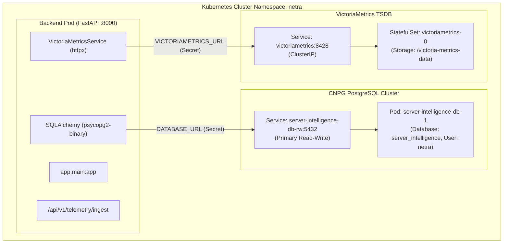

# Netra Intelligence — Kubernetes Backend Audit & Design

**Date**: September 2026  
**Document Status**: Technical Audit & Design Specification (Phase 2B Step 3 Preparation)  
**Target File**: `docs/kubernetes_backend_audit.md`  

---

## 1. Current Backend Container Architecture

The **Server Intelligence Backend** is a FastAPI REST API application built on Python 3.12-slim. It serves as the central intelligence hub, handling:
- **Telemetry Ingestion**: Receives Gzip-compressed metrics batches at `/api/v1/telemetry/ingest`, formats Prometheus line metrics, and writes to VictoriaMetrics and PostgreSQL.
- **Relational Data Persistence**: Uses SQLAlchemy ORM over `psycopg2-binary` to store user authentication (`users`), AI configuration (`ai_settings`), system alerts (`alerts`), and fallback telemetry samples (`telemetry_samples`).
- **ML Intelligence Pipeline**: Loads models into process memory during FastAPI startup (`lifespan` in `main.py`). Provides multi-horizon forecasting (iTransformer primary + HistGradientBoosting fallback) and anomaly detection (Isolation Forest).
- **LLM Integration**: Interacts with local/remote LLM endpoints (`Ollama`).

### Current Build & Packaging Mechanism (`backend/Dockerfile`)
- **Base Image**: `python:3.12-slim`
- **Application Directory**: `/app` (`backend/app` copied to `/app/app`)
- **Dependencies**: `backend/requirements.txt` (includes `fastapi`, `uvicorn`, `sqlalchemy`, `psycopg2-binary`, `scikit-learn`, `joblib`, `numpy`, `pandas`, `pwdlib`, `PyJWT`, `cryptography`).
- **ML Artifact Acquisition**: During Docker build, `curl` downloads the official model release tarball from GitHub (`server-intelligence-models-v1.tar.gz`) and extracts it into `/app/ml`.
- **Exposed Port & Command**: Port `8000`, running `uvicorn app.main:app --host 0.0.0.0 --port 8000`.

---

## 2. ML Artifact Packaging Strategy Analysis

| Artifact Component | Production Model Architecture | Storage Location in Container | Packaging & Loading Mechanism |
|---|---|---|---|
| **Primary Forecast** | PyTorch `iTransformerAdapter` (`ml/bdh/adapters_itransformer.py`) | `/app/ml/models/forecasting/ubuntu/itransformer.pt` | Downloaded via Dockerfile build `ARG MODEL_URL`. Evaluated first by `ml_loader.get_itransformer_model()`. |
| **Fallback Forecast** | `HistGradientBoostingRegressor` per target (`cpu`, `memory`, `load_1m`) and horizon (`5m`, `15m`, `30m`, `1h`, `3h`) | `/app/ml/models/forecasting/ubuntu/{target}_{horizon}.joblib` | Loaded via `joblib.load()` on startup by `MLLoader.load_forecasting_models()`. |
| **Anomaly Detection** | `IsolationForest` pipeline + `TelemetryPreprocessor` | `/app/ml/models/anomaly/ubuntu/isolation_forest.joblib` | Loaded via `AnomalyDetector` class on startup by `MLLoader.load_anomaly_detector()`. |

### Conclusion on Dockerfile & Image Reuse:
- The existing `backend/Dockerfile` can be **reused unchanged** for Kubernetes.
- All 3 ML model tiers (iTransformer, HGB fallback, and Isolation Forest) are bundled directly into the container image during docker build.

---

## 3. Environment Variables Strategy

In Kubernetes, environment variables are classified into ConfigMaps (non-sensitive configuration) and Kubernetes Secrets (sensitive connection strings and keys):

### A. Non-Sensitive Settings (ConfigMap: `netra-backend-config`)
- `FORWARD_SPOOL_DIR`: `/app/forward_spool`
- `ACCESS_TOKEN_EXPIRE_MINUTES`: `480`
- `OLLAMA_URL`: `http://host.docker.internal:11434/api/chat` (or external LLM gateway)

### B. Sensitive Settings (Kubernetes Secret: `netra-backend-secrets`)
- `DATABASE_URL`: `postgresql+psycopg2://netra:<password>@server-intelligence-db-rw.netra.svc.cluster.local:5432/server_intelligence`
- `VICTORIAMETRICS_URL`: `http://victoriametrics.netra.svc.cluster.local:8428`
- `TELEMETRY_SECRET_TOKEN`: Shared secret token for telemetry ingestion authentication.
- `JWT_SECRET_KEY`: Secret key for PyJWT token signature (`HS256`).
- `FORWARD_TELEMETRY_URL` / `FORWARD_TELEMETRY_TOKEN`: Optional cloud telemetry forwarding endpoints.

---

## 4. Kubernetes Service In-Cluster Endpoint Mapping



### Explicit Endpoint Transformations:
1. **PostgreSQL Target**:
   - *Previous Compose*: SQLite file `/app/server_intelligence.db` or external URL.
   - *Kubernetes Target*: `postgresql+psycopg2://netra:<password>@server-intelligence-db-rw.netra.svc.cluster.local:5432/server_intelligence`
   - *Security Rule*: Kept strictly internal to `netra` namespace. **Not exposed via Traefik or NodePort**.
2. **VictoriaMetrics Target**:
   - *Previous Compose*: `http://victoriametrics:8428` / `http://localhost:8428`
   - *Kubernetes Target*: `http://victoriametrics.netra.svc.cluster.local:8428`
   - *Security Rule*: Kept strictly internal to `netra` namespace. **Not exposed via Traefik**.

---

## 5. Health Probes, Container Port & Filesystem Volumes

### A. Container Port & Health Endpoint
- **Container Port**: `8000` (TCP)
- **Liveness Probe**: `HTTP GET /health` on port `8000` (`initialDelaySeconds: 15`, `periodSeconds: 10`)
- **Readiness Probe**: `HTTP GET /health` on port `8000` (`initialDelaySeconds: 10`, `periodSeconds: 5`)

### B. Filesystem & Storage Volume Requirements
1. **Forward Spool Directory (`/app/forward_spool`)**:
   - Used by `forwarder.py` for transient offline retry queue files when cloud forwarding is active.
   - Volume Type: `emptyDir` mounted at `/app/forward_spool`.
2. **ML Models Directory (`/app/ml/models`)**:
   - Pre-packaged inside container image during Docker build.
   - If hot-reloading/retraining is triggered dynamically (`POST /api/v1/intelligence/retrain`), an `emptyDir` or shared PVC can be attached if write persistence across pod restarts is required.

---

## 6. Proposed Kubernetes Deployment & Service Specification

```yaml
# Conceptual Manifest Specification for Step 4 Execution
apiVersion: apps/v1
kind: Deployment
metadata:
  name: backend
  namespace: netra
  labels:
    app.kubernetes.io/name: backend
    app.kubernetes.io/part-of: netra-intelligence
spec:
  replicas: 1
  selector:
    matchLabels:
      app.kubernetes.io/name: backend
  template:
    metadata:
      labels:
        app.kubernetes.io/name: backend
        app.kubernetes.io/part-of: netra-intelligence
    spec:
      containers:
        - name: backend
          image: netra-backend:local
          imagePullPolicy: IfNotPresent
          ports:
            - name: http
              containerPort: 8000
          envFrom:
            - configMapRef:
                name: netra-backend-config
            - secretRef:
                name: netra-backend-secrets
          resources:
            requests:
              cpu: 200m
              memory: 512Mi
            limits:
              cpu: 1000m
              memory: 1024Mi
          livenessProbe:
            httpGet:
              path: /health
              port: 8000
            initialDelaySeconds: 15
            periodSeconds: 10
          readinessProbe:
            httpGet:
              path: /health
              port: 8000
            initialDelaySeconds: 10
            periodSeconds: 5
          volumeMounts:
            - name: forward-spool
              mountPath: /app/forward_spool
      volumes:
        - name: forward-spool
          emptyDir: {}
---
apiVersion: v1
kind: Service
metadata:
  name: backend
  namespace: netra
  labels:
    app.kubernetes.io/name: backend
    app.kubernetes.io/part-of: netra-intelligence
spec:
  type: ClusterIP
  ports:
    - name: http
      port: 8000
      targetPort: 8000
      protocol: TCP
  selector:
    app.kubernetes.io/name: backend
```

---

## 7. Migration Risks & Mitigation Strategy

1. **Database Secret Dependency**: Backend pod startup executes `init_database()` (`Base.metadata.create_all()`). The secret `netra-backend-secrets` must construct the exact `DATABASE_URL` using credentials extracted from the CNPG secret `server-intelligence-db-app`.
2. **Local Image Import**: The Docker image `netra-backend:local` must be built locally on the Mac M2 host (`docker build -t netra-backend:local -f backend/Dockerfile .`) and imported into k3d via `k3d image import netra-backend:local -c netra`.
3. **Database Connection Warmup**: CNPG PostgreSQL instance `server-intelligence-db-rw` is healthy and ready to accept connection requests.

---

*Audit completed by Antigravity Agent. Document generated at `docs/kubernetes_backend_audit.md`.*
